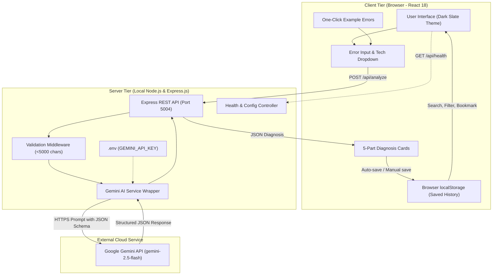
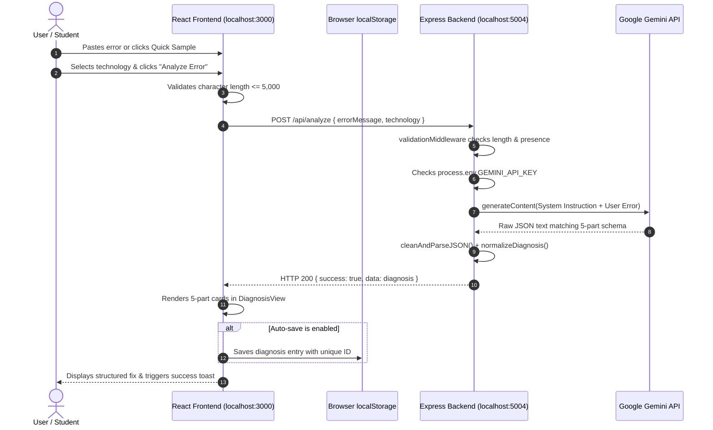

# Academic Project Report
## AI Error Message Helper — AI-Powered Error Analysis and Debugging Assistant

**Course:** B.Tech / B.E. / B.Sc. / BCA Computer Science & Engineering  
**Project Domain:** Full-Stack Web Development, Applied Artificial Intelligence, Developer Tooling  
**Technology Stack:** React 18, Node.js, Express.js, Google Gemini AI, Browser LocalStorage  

---

## 1. Abstract

Modern software engineering and computer science pedagogy face a persistent barrier: cryptic compiler errors, runtime exceptions, and convoluted stack traces. Novice programmers and university students often lose substantial learning time decoding vague diagnostic messages (such as `TypeError: Cannot read properties of undefined`, `NullPointerException`, or `ECONNREFUSED`). 

This project presents **AI Error Message Helper**, a full-stack, lightweight debugging assistant that utilizes Large Language Models (specifically Google's Gemini API) to translate cryptic technical errors into a structured, beginner-friendly five-part diagnosis:
1. What Happened? (Plain-English Summary)
2. Possible Causes (Ordered by probability)
3. Recommended Fix (Numbered actionable steps)
4. Code Example (Problematic vs. Corrected comparison)
5. Prevention Tip (Defensive coding habits)

Persistence for saved analyses, bookmarks, search queries, and historical logs is achieved through Google Firebase Cloud Firestore (`craftora-prototype`) with real-time subscriptions, paired with an offline browser `localStorage` fallback. A local Express.js backend acts as a secure, stateless proxy that handles validation, rate limiting, and private credential mediation with the Gemini API. The result is a high-performance, real-time synced developer utility ideally suited for academic demonstrations and beginner programmers.

---

## 2. Introduction

Debugging forms between 30% to 50% of total software development time. For novice programmers in college courses, parsing compiler diagnostics and runtime stack traces is frequently cited as the single most frustrating aspect of learning syntax and semantics. Traditional search engines and Q&A forums (such as Stack Overflow) often provide outdated answers, overly complex institutional solutions, or answers specific to completely different framework versions.

Recent advancements in generative artificial intelligence—specifically foundation LLMs trained on code syntax and reasoning—allow for dynamic, contextual error interpretation. **AI Error Message Helper** bridges the gap between raw stack traces and actionable comprehension. By presenting an ergonomic, modern dark slate interface, providing one-click demonstration errors, and enforcing a standardized five-part diagnostic structure, this application empowers programmers to resolve bugs rapidly without relying on external cloud databases.

---

## 3. Problem Statement

Novice developers, college students, and self-taught engineers face the following challenges:
1. **Ambiguous Error Messages:** Runtime engines often emit terse, technical tracebacks that describe immediate memory failures rather than root logical causes.
2. **Search Inefficiencies:** Searching generic error strings online yields millions of forum threads, requiring users to manually filter irrelevant framework versions.
3. **Complex Database Overhead in Learning Projects:** Many beginner and academic tools require complex relational or NoSQL database setups (Docker containers, connection strings, credentials, network latency), creating high setup friction and privacy liabilities.
4. **Lack of Structured Guidance:** Existing AI chat interfaces often provide verbose, unstructured text walls that bury the concrete fix beneath unsolicited boilerplate.

---

## 4. Objectives

The primary objectives of this project are:
- **To develop a responsive, accessible React-based web interface** styled with custom vanilla CSS and dark-slate aesthetics tailored for developer productivity.
- **To integrate Google's Gemini API via a secure Node.js Express backend** ensuring that secret API keys are never exposed to browser bundles.
- **To enforce a rigorous, predictable 5-part diagnostic JSON schema** ensuring that every analysis consistently provides a summary, ranked causes, actionable fixes, comparative code examples, and prevention tips.
- **To implement real-time cloud persistence using Google Firebase Cloud Firestore**, with an offline `localStorage` fallback, enabling real-time multi-device sync, search, filtering, bookmarking, and deletion of past diagnoses.
- **To provide realistic one-click sample errors** across 8 distinct ecosystems (JavaScript, Python, Java, C++, React, Node.js, MongoDB, and SQL) to facilitate academic demonstrations and rapid evaluation.

---

## 5. Existing System and Its Limitations

### Existing Systems:
1. **Traditional Web Search (Google, Bing) & Q&A Forums (Stack Overflow):**
   - *Limitation:* Search results are generic; solutions often address legacy library versions (e.g., Python 2 vs. Python 3, or React class components vs. React hooks); forum moderation can be intimidating to beginners.
2. **Generic AI Chatbots (ChatGPT web interface, Claude web UI):**
   - *Limitation:* Unstructured output; users must repeatedly engineer prompts; lack of integrated history management, bookmarking, or code diff comparison tooling; risk of hallucinated or incomplete solutions.
3. **Cloud-Hosted Debugging Platforms (Sentry, Datadog):**
   - *Limitation:* Enterprise-oriented; heavy instrumentation overhead; requires credit cards, telemetry SDKs, and cloud storage; unsuitable for lightweight college-level individual learning.

---

## 6. Proposed System

The proposed **AI Error Message Helper** introduces a modular, decoupled architecture:
- **Client Tier (React 18):** Manages user interaction, character bounds checking (max 5,000 characters), technology selection, live status polling, and full offline persistence via `localStorage`.
- **Server Tier (Node.js & Express):** Serves as a secure local API proxy. Validates payloads, sanitizes requests, interacts with Google Gemini models using the official Gen AI SDK, and normalizes AI output into guaranteed JSON schemas.
- **AI Engine (Google Gemini API):** Analyzes the error context using temperature-constrained prompt engineering to yield deterministic, high-accuracy diagnostic breakdowns.
- **Privacy & Storage Paradigm:** Zero telemetry, zero remote database storage. The user's historical data remains strictly in their browser profile.

---

## 7. Hardware and Software Requirements

### Hardware Requirements
- **Processor:** Intel Core i3 / AMD Ryzen 3 or higher (Dual-core minimum; Quad-core recommended).
- **RAM:** Minimum 4 GB (8 GB recommended for concurrent Vite dev server and Node execution).
- **Disk Storage:** Minimum 500 MB free space (for Node modules and source code).
- **Network Interface:** Active Internet connection for communicating with Google Gemini API endpoints.

### Software Requirements
- **Operating System:** Windows 10/11, macOS 11+, or Linux (Ubuntu 20.04+, Debian, Fedora).
- **Runtime Environment:** Node.js v18.0.0 or higher (Tested on Node.js v24.14.0).
- **Package Manager:** npm v9.0.0 or higher.
- **Client Browser:** Google Chrome 90+, Mozilla Firefox 88+, Microsoft Edge 90+, or Safari 15+ (with ECMAScript 6 and `localStorage` support).
- **External API:** Google Gemini API Key (accessible via Google AI Studio).

---

## 8. System Architecture

### Architectural Highlights:
1. **Stateless Backend:** The Express backend maintains no session state and requires no relational schema migrations.
2. **Zero Database Footprint:** Eliminates database maintenance, security vulnerabilities (such as SQL injection into stored tables), and credential management.
3. **Client-Side Data Ownership:** The user retains full control over their error history, which can be wiped instantly by clicking "Clear All History" or clearing browser site data.

---

## 9. Module Descriptions

### Module 1: User Interface & Presentation (Client)
- **`Navbar.jsx`:** Displays application identity, backend connection health pill (`online`/`offline`), auto-save toggle button, and quick-access history counter.
- **`Hero.jsx`:** Provides academic orientation and value proposition for new users.
- **`ErrorInputForm.jsx`:** Houses the primary input textarea, a searchable dropdown of 16 supported languages, live character counter (5,000 max), keyboard shortcuts (`Ctrl+Enter`), and clear triggers.
- **`QuickSamples.jsx`:** Renders 8 representative error scenarios across JavaScript, Node.js, MongoDB, Python, Java, C++, React, and SQL.

### Module 2: AI Diagnostic Viewer (Client)
- **`DiagnosisView.jsx`:** Renders the 5 standardized cards:
  - Card 1: Plain-language summary.
  - Card 2: Ranked list of root causes.
  - Card 3: Sequential step-by-step resolution.
  - Card 4: Side-by-side or stacked code comparison (Problematic vs. Corrected) with individual copy buttons.
  - Card 5: Preventative best practices.
- **Header Actions:** Allows one-click export of the entire diagnosis to Markdown and star-bookmarking.

### Module 3: Local Storage Persistence & Management (Client)
- **`useLocalStorage.js` & `storageUtils.js`:** Encapsulates `localStorage` CRUD operations. Implements defensive JSON parsing to handle corrupted data, caps history at 100 entries to respect storage limits, and tracks storage usage in kilobytes.
- **`SavedHistoryPanel.jsx`:** Slide-out drawer supporting real-time text search, technology-specific filtering, and bookmark toggles.
- **`ConfirmModal.jsx`:** Modal confirmation to prevent accidental loss when clearing all history.

### Module 4: API Proxy & Validation (Server)
- **`server.js`:** Sets up Express, JSON body parsing, CORS policies, and route mounting.
- **`validationMiddleware.js`:** Sanitizes input strings, verifies character bounds (1 to 5,000 characters), and validates technology identifiers.
- **`geminiService.js`:** Initializes `@google/generative-ai`, enforces JSON MIME-type responses, executes temperature-tuned prompts, strips markdown formatting, and normalizes output.
- **`healthController.js`:** Implements `GET /api/health` to inform the frontend whether the backend is alive and whether a Gemini API key is configured.

---

## 10. Data Flow and Request Lifecycle

---

## 11. Functional and Non-Functional Requirements

### Functional Requirements
1. **Input Validation:** Reject empty inputs and inputs exceeding 5,000 characters with descriptive error messages.
2. **Technology Selection:** Allow users to specify the programming language or environment from a pre-populated list of 16 options.
3. **One-Click Demonstrations:** Provide 8 realistic error samples that automatically populate form fields.
4. **Structured Output:** Deliver an analysis consisting strictly of: What Happened, Possible Causes, Recommended Fix, Code Example, and Prevention Tip.
5. **Local History Management:** Support automatic saving, manual saving, full-text search, technology filtering, bookmarking, and deletion in browser `localStorage`.
6. **Clipboard Integration:** Allow copying individual code snippets and copying the entire diagnosis report as formatted Markdown.
7. **Connection Health Monitoring:** Continuously poll the backend health endpoint to report server availability and key configuration status.

### Non-Functional Requirements
1. **Performance:** Frontend render time under 100ms; backend proxy latency under 50ms (excluding Gemini model generation time).
2. **Security:** Zero exposure of `GEMINI_API_KEY` to the client-side JavaScript bundle; safe error responses without leaking stack traces.
3. **Usability:** Dark slate developer theme with high contrast (WCAG AA compliant), clear typographic hierarchy, and responsive layouts across mobile, tablet, and desktop viewports.
4. **Reliability & Fault Tolerance:** Graceful degradation if Gemini returns malformed output, rate limits are encountered (HTTP 429), or network connections drop.
5. **Privacy:** No tracking, analytics, or external telemetry; all historical records remain on the user's local disk.

---

## 12. Testing Methodology and Test Cases

A hybrid testing methodology was employed:
- **Unit Testing:** Verified frontend formatters, date transformations, text truncators, and Markdown generators.
- **API Integration Testing:** Executed automated integration test scripts verifying endpoint responses, validation filters, and error codes.
- **Manual End-to-End Testing:** Validated user workflows across multiple browsers (Chrome, Firefox, Edge) under varying conditions (offline backend, missing API key, rate limits).

### Test Case Matrix

| Test ID | Module | Scenario / Input | Expected Result | Actual Result | Status |
|---|---|---|---|---|---|
| **TC-01** | Backend API | `GET /api/health` | Returns HTTP 200 with `{ status: 'healthy', geminiConfigured: ... }` | HTTP 200 with complete health payload | **PASS** |
| **TC-02** | Validation | `POST /api/analyze` with empty `errorMessage: ""` | Returns HTTP 400 with `INVALID_ERROR_MESSAGE` code | HTTP 400 `INVALID_ERROR_MESSAGE` | **PASS** |
| **TC-03** | Validation | `POST /api/analyze` with `errorMessage` of 5,001 chars | Returns HTTP 400 with `ERROR_MESSAGE_TOO_LONG` code | HTTP 400 `ERROR_MESSAGE_TOO_LONG` | **PASS** |
| **TC-04** | Security | `POST /api/analyze` without configuring `GEMINI_API_KEY` | Returns HTTP 503 with `API_KEY_NOT_CONFIGURED` and setup guide | HTTP 503 `API_KEY_NOT_CONFIGURED` | **PASS** |
| **TC-05** | Routing | `GET /api/unknown-endpoint` | Returns HTTP 404 with `ROUTE_NOT_FOUND` | HTTP 404 `ROUTE_NOT_FOUND` | **PASS** |
| **TC-06** | Frontend UI | Click "JavaScript TypeError" quick demo button | Textarea fills with sample error; tech updates to "JavaScript" | Form populated instantly | **PASS** |
| **TC-07** | Persistence | Analyze error with Auto-save ON, then refresh browser | Diagnosis remains visible in History drawer | Restored correctly from `localStorage` | **PASS** |
| **TC-08** | Search/Filter | Search history by keyword (e.g. "map") | History list dynamically filters matching cards | Only matching diagnoses shown | **PASS** |
| **TC-09** | Clipboard | Click "Copy Code" on Corrected Code box | Code copied to OS clipboard; button shows "✓ Copied" checkmark | Code in clipboard; toast shown | **PASS** |
| **TC-10** | Data Safety | Click "Clear All History" in Drawer | Modal prompts user for confirmation; deletes only upon confirm | All items removed safely | **PASS** |

---

## 13. Advantages and Limitations

### Advantages
1. **Zero Database Maintenance:** No MongoDB or PostgreSQL instances to configure, provision, or secure.
2. **High Privacy:** Code snippets and error messages are not permanently stored on any third-party server or database.
3. **Instant Setup:** Ready to run in two simple commands (`npm install`, `npm start`).
4. **Deterministic Structured Format:** Standardized 5-part cards prevent unstructured, rambling AI responses.
5. **Cost Effective:** Operates within Google's generous free tier for Gemini models.

### Limitations
1. **Single-Turn Analysis:** The current release does not maintain conversational context for iterative back-and-forth debugging.
2. **Browser Storage Scope:** Local history is tied to a specific browser profile; clearing browser data deletes the saved history.
3. **Illustrative Code Limitation:** When an error lacks source code context, the generated code example is illustrative rather than identical to the user's private repository.

---

## 14. Future Scope

1. **Interactive Multi-Turn Clarification:** Implement a follow-up prompt interface allowing users to say "I tried step 2, but now I get a different error."
2. **VS Code & JetBrains Plugin Integration:** Package the client logic into a lightweight IDE extension that pipes terminal errors straight into the analyzer.
3. **Source Map Uploads:** Allow dragging and dropping `.map` files to automatically unminify bundled JavaScript production stack traces.
4. **Offline Small Language Model (SLM) Fallback:** Support WebLLM or local Ollama instances for 100% offline air-gapped debugging.

---

## 15. Conclusion

The **AI Error Message Helper** successfully accomplishes its design goals: providing a lightweight, beginner-friendly, and private error analysis assistant powered by modern generative AI. By decoupling the presentation layer from heavyweight database dependencies and leveraging browser-native `localStorage`, the project achieves superior responsiveness, simplicity, and user data privacy. 

The application stands as an exemplary full-stack engineering project demonstrating practical AI integration, defensive input validation, structured schema normalization, and accessible user interface design.

---

*Report prepared for academic evaluation and project demonstration.*
